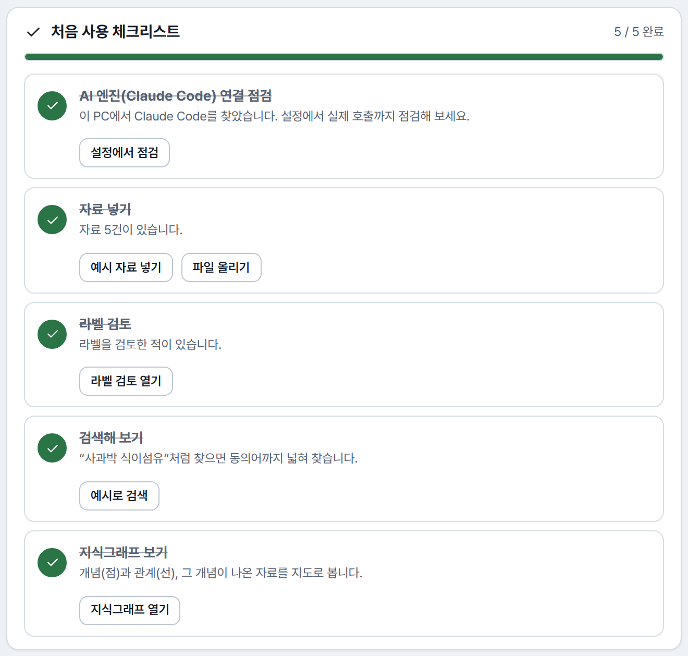
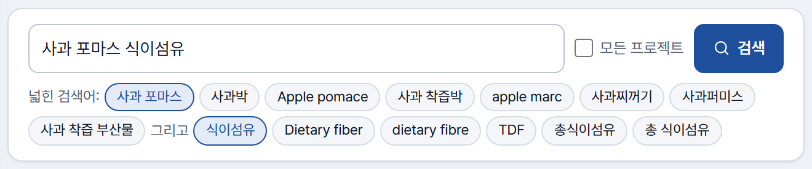
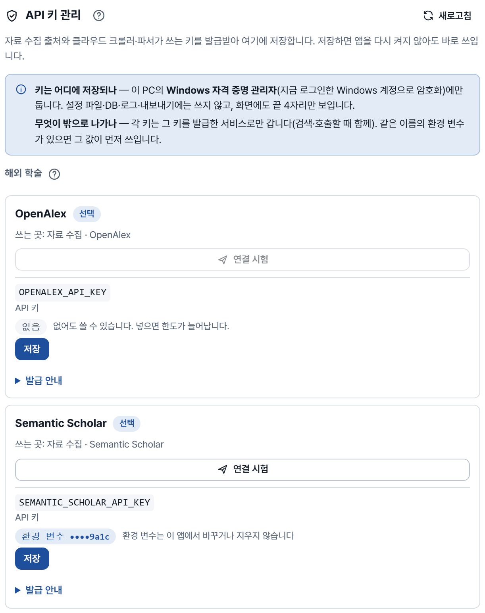

# R&D Studio V0.5 — 빠른 사용 설명서

부산물 연구 자료(논문·보고서·CoA)를 **내 PC에서** 모으고, 찾고, AI(Claude Code)에게 근거 있는 답을 받는 앱입니다.
이 문서는 처음 쓰는 사람이 10분 안에 따라 할 수 있게 핵심만 담았습니다. 자세한 설명은 안내서 `guidebook/final/guidebook.pdf`(「연구실에 AI 동료 들이기」)를 보세요.

> 모르는 화면에서는 메뉴·제목 옆의 **(?)** 를 누르세요. 용도·쓰는 법·PC 밖으로 나가는 것이 나옵니다.

---

## 1. 설치 (처음 한 번, Windows)

| 단계 | 할 일 |
|---|---|
| ① | **Python 3.11 이상** 설치 — `winget install Python.Python.3.12` (설치 때 "Add to PATH" 체크) |
| ② | **Claude Code** 설치 후 로그인 — PowerShell에서 `irm https://claude.ai/install.ps1 \| iex` → 터미널에서 `claude` 한 번 실행해 로그인 |
| ③ | 이 프로젝트 받기 — `git clone <저장소 주소>` 또는 ZIP을 받아 풀기 (비공개 저장소라 접근 권한 필요) |
| ④ | 폴더의 **`install.bat`** 더블클릭 — 끝에 "내 Claude Code 대화창에도 자료 도구를 등록할까요? (Y/n)"가 나오면 Enter |
| ⑤ | **`start.bat`** 더블클릭 → 브라우저에 `http://127.0.0.1:8765`가 열림 (끝낼 때는 검은 창에서 Ctrl+C) |

![install.bat 실행 모습(예시 — 새 판은 마지막 [5/5] 단계에서 Claude Code 로그인 확인 후 자료 도구 등록 여부를 묻습니다)](../guidebook/assets/s23a-install.png)

*그림: install.bat 실행 모습(예시). 새 판은 마지막 [5/5] 단계에서 Claude Code 로그인을 확인하고 자료 도구 등록 여부를 묻습니다.*

---

## 2. 처음 켜면 — 시작 화면의 체크리스트대로

앱을 켜면 **시작** 화면이 열립니다. 체크리스트를 위에서부터 누르면 됩니다.

1. **AI 엔진 연결 점검** → 설정의 **Claude Code 연결 마법사**에서 ①설치 ②로그인이 초록색인지 확인 (③ 실제 호출 점검은 사용량이 조금 듭니다)
2. **자료 넣기** → "예시 자료 넣기"(가짜 수치의 연습 자료) 또는 "파일 올리기"
3. **라벨 검토** → AI·사전이 붙인 라벨을 승인(A)·거절(R)
4. **검색해 보기** → "사과박 식이섬유"처럼 찾으면 동의어까지 넓혀 찾습니다
5. **지식그래프 보기** → 개념(점)과 관계(선)로 이어진 지도

왼쪽 메뉴는 **시작 / 자료 / 라벨 / 실험·분석 / 보기·AI / 설정**으로 묶여 있고, 위쪽 검색창(**Ctrl+K** 또는 **/**)은 어디서든 씁니다.

---

## 3. 자주 하는 일 — 한 줄씩

| 하고 싶은 일 | 어디서 | 어떻게 |
|---|---|---|
| 논문·보고서·CoA 넣기 | **자료함** | 파일을 끌어다 놓기. 보안 등급(일반·내부·기밀)을 고름. PDF·HWP/HWPX·XLSX·TXT·이미지 |
| 자료에서 찾기 | **검색** | 검색어 입력 → 결과를 누르면 원문과 라벨 |
| AI에게 묻기 | **AI에 묻기** | 질문 입력 → 출처가 달린 답. 출처를 누르면 원문이 열림 |
| 수치 정리 보기 | **측정값** | CoA 값과 승인한 추출값. "근거 청크"로 원문 확인, CSV 저장 |
| 새 논문 찾아 모으기 | **자료 수집** | 검색어 + 출처 선택 → **수집함**에서 검토 → "자료함에 넣기" |
| 문서를 깊게 다루기 | 자료함의 **작업대** | 파서 고르기·청크 고치기·라벨 직접 붙이기·배운 것 관리 |
| 내 실험 데이터로 비교 | **내 실험** | 공정 흐름 고르기 → 런 데이터 입력/가져오기 → 예측과 비교·보정 |
| 논문용 통계 | **통계 분석** | 데이터·변수 고르기 → 분석 실행 → 표 1·그림 1·해석 세 문장 받기 |
| 공정·분자 그림 보기 | **시각화** | 건조 설비 3D·건조 결과 예측(근거 표시)·분자 구조 |

---

## 4. API 키 넣기 (필요할 때만)

해외 학술 검색(OpenAlex 등)은 키 없이 됩니다. 국내 학술·특허·공공데이터·클라우드 기능은 키가 필요합니다.

1. **설정 → API 키 관리**에서 쓰려는 출처의 **발급 안내**를 열어 기관 누리집에서 키를 받습니다.
2. **저장**을 누르고 키를 붙여 넣습니다. 키는 **Windows 자격 증명 관리자**에만 저장되고 파일·DB에는 남지 않습니다.
3. **연결 시험**으로 확인합니다.

> Chrome이 키를 비밀번호로 저장할지 물으면 **저장 안함**을 누르세요.

---

## 5. 내 Claude Code 대화창에서도 쓰기 (선택)

설정 → **Claude Code 연결 마법사** ④에서 **등록**하면, 이 PC의 어떤 Claude Code 대화에서든
`byorbit-rd로 사과박 식이섬유 자료 찾아줘`처럼 앱의 자료를 쓸 수 있습니다.
명령창: `.venv\Scripts\python -m app.cli setup-claude --check` / `--register` / `--unregister`

> 보안: 내 Claude Code 대화창에서는 Claude가 자기 파일 읽기 도구도 씁니다. **기밀 자료는 앱 안 "AI에 묻기"로** 다루세요(앱 안에서는 AI의 파일 도구를 모두 끄고 실행합니다).

---

## 6. 무엇이 PC 밖으로 나가나

| 기능 | 나가는 것 |
|---|---|
| 자료함·검색·라벨 검토·측정값·실험·통계·시각화 | **없음** (이 PC 안에서만) |
| AI에 묻기·AI 라벨 | 질문과 **가려진** 본문 일부 → Anthropic (CoA의 로트·공급처·시료번호는 `[가림]`, '보내지 않기' 규칙이면 기밀 본문은 아예 안 보냄) |
| 자료 수집 | 검색어(와 그 출처의 API 키)만 |
| 클라우드 파서·Apify | 문서 파일·사이트 주소 (기밀 문서는 클라우드 파서 차단) |

---

## 7. 다른 PC로 옮길 때 / 문제가 생겼을 때

- **다른 PC**: 1장의 설치를 그대로 → 연결 마법사 → API 키 다시 넣기(키는 PC마다 따로) → 데이터는 데이터 폴더(`C:\Users\<이름>\ByOrbit-RD`)를 통째로 복사.
- **"Claude Code 설치 안 됨"으로 보임**: 설정 → 연결 마법사 → **다시 확인**. 터미널에서 `claude --version`이 되는지 보고, 안 되면 Claude Code를 다시 설치.
- **화면이 이상함**: 브라우저에서 **Ctrl+F5**(새로고침).
- **백업**: 데이터 폴더를 통째로 복사하면 끝.
- 더 자세한 문제 해결: 안내서 부록(FAQ), `README.md`.
